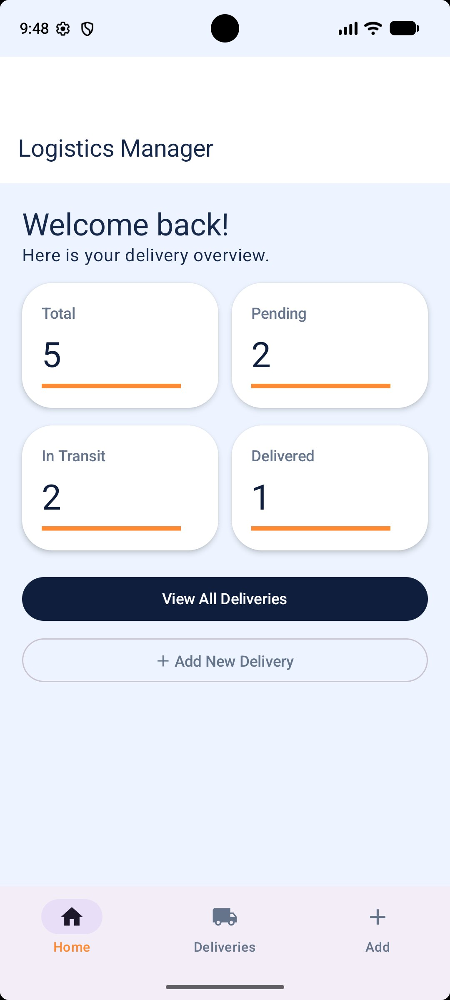
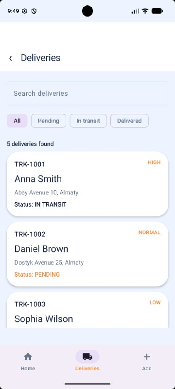
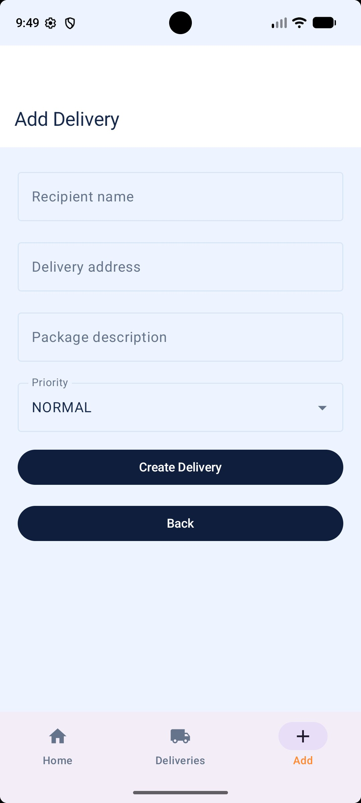

# Logistics Delivery Manager

## Project Description

Logistics Delivery Manager is an Android application developed using Kotlin and Jetpack Compose. It helps users manage delivery records, track delivery statuses, and view delivery statistics.

The application provides a simple interface for organizing delivery information and monitoring delivery progress.

## Features

- **Dashboard:** Displays the total number of deliveries and statistics for pending, in-transit, and delivered packages.
- **Delivery List:** Displays delivery records with tracking numbers, recipient names, addresses, priorities, and statuses.
- **Search:** Allows users to search for deliveries by tracking number, recipient name, or address.
- **Status Filtering:** Filters deliveries by status.
- **Delivery Details:** Displays detailed information about a selected delivery.
- **Status Management:** Allows users to update delivery statuses or cancel pending and in-transit deliveries.
- **Add Delivery:** Allows users to create a delivery by entering recipient information, an address, a package description, and a priority.

## Technologies Used

- Kotlin
- Jetpack Compose
- Material 3
- Navigation Compose
- ViewModel
- StateFlow
- Lifecycle-aware state collection

## Project Structure

- `data` — delivery data model and repository.
- `navigation` — navigation between application screens.
- `ui/screens` — application screens and reusable UI components.
- `ui/theme` — application colors and theme.
- `viewmodel` — application state and delivery management logic.

## Getting Started

### Requirements

- Android Studio
- Android SDK compatible with the project configuration
- An Android emulator or a physical Android device

### How to Run

1. Clone or download this repository.
2. Open the project in Android Studio.
3. Wait for Gradle Sync to finish.
4. Run the application on an emulator or a connected Android device.

## Screenshots

### Dashboard

### Deliveries

### Add Delivery

## Data Storage

The application currently uses sample delivery data provided by a local repository. Delivery changes are held in application memory and are not persisted in a database.

## Author

Student Android application project.